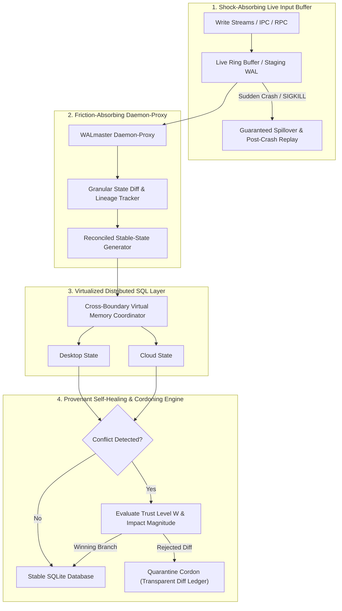

# User-FoundingSolutions: The Self-Healing, Provenant SQL Reconciliation Architecture

**Project:** WALmaster  
**Document:** Founding Architectural Vision & Core Solutions  
**Originator / Architect:** System Operator (User Founding Directive)  
**Location:** `B:\CRSDL-MACCRE\walmaster\User-FoundingSolutions.md`  

---

## 1. The Core Vision: Transcending the Limits of Traditional SQL

Traditional relational databases (and SQLite in particular) operate under a rigid, single-node physical assumption:
> *Transactions succeed or fail based on localized, hardware-bound POSIX/Win32 locks and shared memory buses (`.db-shm`). When network barriers, cloud sync latency, or abrupt process crashes intervene, the system breaks down into torn B-trees, orphaned rowids, and locked files.*

Rather than applying superficial band-aids (such as naive periodic backups or brute-force file unlinking), **WALmaster sets out to elevate SQL itself**:
We introduce an active, provenantly-weighted reconciliation layer that absorbs the friction of hybrid desktop/cloud computing, virtualizes shared memory across boundaries, and transforms SQL into a self-healing, auditable, and resilient data plane.

---

## 2. The Four Founding Architectural Pillars

---

### Pillar I: The Cross-Boundary Virtual Shared Memory Layer
* **The Challenge:** "Shared memory pointers cannot cross network or machine boundaries."
* **The Solution:** *Convince them to.*
  WALmaster virtualizes the `.db-shm` index through a distributed memory arbitration protocol. By intercepting page-mapping requests, the reconciliation layer creates a coherent virtual shared memory space across desktop Electron and cloud runners. Changes to page hash tables are broadcast and lease-locked, preventing split-brain writes before they can ever hit the underlying disk image.

---

### Pillar II: The Friction-Absorbing Daemon-Proxy
* **The Challenge:** "Sync daemons sync `.db`, `.db-wal`, and `.db-shm` independently rather than atomically, producing conflict files (`*(1).db-wal`) and torn writes."
* **The Solution:** An active daemon-proxy that sits directly between external sync processes (Google Drive, OneDrive, cloud tunnels) and the physical database:
  1. **Shock Absorption:** Absorbs the timing volatility and race conditions of multi-client file synchronization.
  2. **Granular State Lineage:** Tracks database state mutations with git-like granularity (recording every commit frame as an atomic changeset).
  3. **Reconciled Stable States:** In the event of a sync collision, the proxy intercepts the divergent files, calculates the semantic delta, reconciles conflicting page frames, and presents a single, verified stable state to both sides.

---

### Pillar III: The Live Volatility Input Buffer
* **The Challenge:** "Electron background worker crashes or abrupt window closures kill processes before `sqlite3_close()` or `PRAGMA wal_checkpoint(TRUNCATE)` can execute."
* **The Solution:** A decoupled live input buffer. 
  Instead of allowing uncoordinated client processes to write directly to sensitive B-tree files on disk, write streams pass through an in-memory/WAL staging ring buffer. 
  If an Electron renderer or remote subagent crashes mid-stream, the live buffer survives, captures the interrupted stream, detects incomplete frames, and cleanly rolls forward or rewinds to the last known stable state upon client reboot.

---

### Pillar IV: Provenance-Weighted Conflict Resolution & Transparent Cordoning
* **The Challenge:** Merging divergent states naively causes silent data clobbering or philosophical drift.
* **The Solution:** A mathematically rigorous, provenantly-guided state reconciliation engine:
  1. **Epistemic Provenance Tracking ($W \in [0, 1)$):** Every modification records who made it (desktop operator, headless cloud subagent, external sync) and the epistemic weight/trust level of that actor.
  2. **Impact Magnitude Scoring:** Evaluates the structural reach of a proposed change (schema alteration vs. single-row text append).
  3. **Transparent Cordoning of Aberrations:** When a merge conflict cannot be cleanly resolved, the rejected diff is **never silently dropped or discarded**. It is cordoned off into a dedicated quarantine ledger (`quarantine_diffs.jsonl` / Merkle branch) with complete forensic diagnostics for transparent operator inspection.

---

## 3. The Ultimate Goal: Self-Healing SQL

A database that does not panic, lock up, or require forensic surgery when an operating system crashes or a cloud network drop occurs.

By uniting **live input buffering**, **proxy friction absorption**, and **provenance-based diff reconciliation**, WALmaster transforms SQLite from a fragile local file into an indestructible, self-healing substrate suited for the next generation of sovereign agentic workflows.
