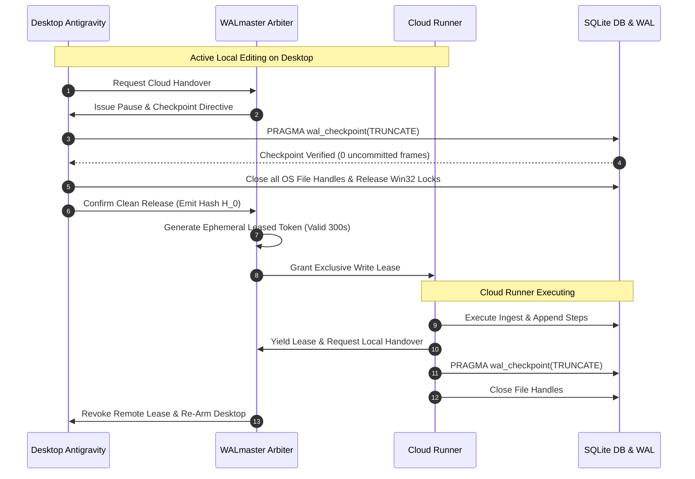

# WALmaster: Mathematical Architecture & Protocol Specification

## 1. Concurrency Physics & Failure Modeling

In Write-Ahead Logging (WAL) mode, SQLite transactions append frames to a `-wal` file instead of directly modifying the database file:
$$F_i = (P_i, D_i, H_i)$$
where $P_i$ is the page number, $D_i$ is the 4096-byte page data, and $H_i$ is the frame header containing salt and cumulative checksums:
$$s_1, s_2, c_1, c_2$$

### The Distributed Failure Condition
SQLite relies on the index file (`-shm`) as a shared-memory hash table mapping database page numbers to WAL frames.
Let $M_{\text{local}}$ and $M_{\text{cloud}}$ represent the local desktop host and remote cloud instance, respectively:
$$\text{MemorySpace}(M_{\text{local}}) \cap \text{MemorySpace}(M_{\text{cloud}}) = \emptyset$$

When a cloud worker appends frame $F_{k}$ without updating the local host's `-shm`, or when a local process checkpoints without synchronizing locks across the network barrier:
$$\text{Checksum}(F_k) \neq \text{ExpectedChecksum}(M_{\text{local}})$$
This produces torn reads, broken B-tree root references, and out-of-order rowid sequences:
$$\text{Tree}(T) \implies \text{Rowid}(C_{j+1}) < \text{Rowid}(C_j) \implies \text{Database Disk Image Malformed}$$

---

## 2. The WALmaster Lease Arbitration Protocol (WLAP)

To allow bidirectional handovers between Desktop Electron and Cloud Runners without torn writes, WALmaster enforces a **Strict 4-Phase Barrier**:



### Invariant 1 (Zero-Frame Handover):
No handover between local and cloud execution may proceed if the number of uncheckpointed WAL frames is non-zero:
$$\text{Frames}_{\text{uncheckpointed}} = 0$$

### Invariant 2 (Handle Drain):
All OS file descriptors and Win32 handle tables must be drained and released before the lease token is transferred:
$$\text{Handles}(M_{\text{active}}) = 0$$

---

## 3. The Two-Tier UI Projection Specification

To guarantee that restored conversations render instantaneously in the Antigravity UI sidebar, the projection engine must update two distinct relational stores simultaneously:

### Tier 1: The Conversation Database (`conversations/<id>.db`)
* **Tables:** `trajectory_meta`, `steps`, `gen_metadata`, `executor_metadata`, `parent_references`, `trajectory_metadata_blob`, `battle_mode_infos`.
* **Index Alignment:**
  ```sql
  CREATE INDEX IF NOT EXISTS `idx_steps_status` ON `steps`(`status`);
  CREATE INDEX IF NOT EXISTS `idx_steps_step_type` ON `steps`(`step_type`);
  ```

### Tier 2: The Global Sidebar Index (`conversation_summaries.db`)
* **Schema:**
  ```sql
  UPDATE conversation_summaries 
  SET step_count = :count, last_modified_time = :timestamp
  WHERE conversation_id = :id;
  ```
* **Presence Lock Nulling:**
  ```powershell
  Remove-Item -Path "C:\Users\wilke\.gemini\antigravity\presence\<id>.lock" -Force -ErrorAction SilentlyContinue
  ```

---

## 4. Empirical Red/Green Verification Matrix

| Verification Target | Test Strategy | Pass Criteria |
| :--- | :--- | :--- |
| **Torn Page Injection** | Subprocess writes 1,000 transactions and aborts with `SIGKILL` / `TerminateProcess`. | `PRAGMA integrity_check` captures exact failure without crashing host. |
| **Lease Arbiter Barrier** | Competing process attempts concurrent write during handover. | Handover request rejected with `LeaseConflictError`; 0 torn frames. |
| **Deterministic Reprojection** | Destroy `.db` file; re-run `reproject_from_jsonl()`. | Healed `.db` passes `PRAGMA integrity_check` in <250ms with 100% row match. |
| **Two-Tier Sidebar Visibility** | Verify `conversation_summaries.db` synchronization. | Antigravity sidebar immediately renders restored session title and step count. |
